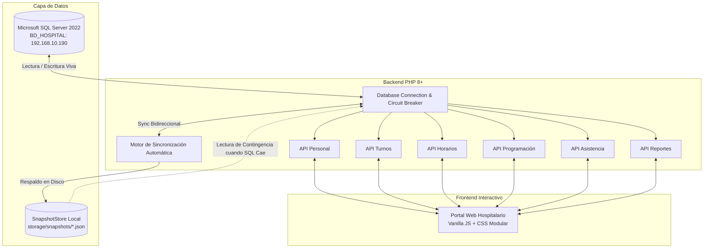

# Sistema Integral de Gestión Hospitalaria y Control de Asistencia (SIGH-MINSA)
## Hospital Distrital de Pacasmayo — Red Integrada de Salud Pacasmayo / GERESA La Libertad

> **Estado actual:** SQL Server es la fuente principal. La programación mensual cuenta con persistencia transaccional SQL y las vistas reutilizan caché de sesión mientras la revisión de datos siga vigente. Los snapshots quedan como respaldo de consulta ante emergencias. Consulte [instalación y funcionamiento SQL/caché](docs/SQL_Y_CACHE.md) y las [correcciones previas](docs/CORRECCIONES_2026-10-26.md). El login exige verificación de hash SQL; los reportes oficiales requieren conexión.

---

## 1. Visión y Propósito del Sistema

El **SIGH-MINSA** es una solución tecnológica web integral desarrollada a medida para el **Hospital Distrital de Pacasmayo**, diseñada para gobernar con precisión matemática y apego normativo el ciclo completo de los recursos humanos asistenciales y administrativos del sector salud público peruano.

El sistema articula en una sola plataforma:
1. **Padrón de Personal y Condición Laboral:** Gestión de servidores bajo regímenes **D.L. 276 (Nombrados)**, **D.L. 1057 (CAS)**, **Ley 31538 (Emergencia)** y Locación de Servicios.
2. **Nomenclatura Oficial de Turnos:** Soporte integral del formato tradicional obligatorio del hospital (**`1`**, **`2`**, **`3`**, **`1/2`**, **`2/3`**, **`1/2/3`**, **`V`**, **`F`**, **`C`**) junto con su correspondencia con el estándar MINSA (**`M`**, **`T`**, **`N`**, **`GD`**, **`GN`**).
3. **Cálculo de Carga Horaria:** Fiscalización en tiempo real de la meta legal de **150 horas mensuales** para el personal asistencial y control de jornadas fijas para el personal administrativo.
4. **Resiliencia Operativa Offline:** Capacidad de operar ininterrumpidamente ante caídas de red o cortes de servidor SQL Server gracias a su motor de persistencia local en snapshots.
5. **Control Biométrico de Asistencia:** Comparación automática de marcas de reloj marcador contra el rol programado, computando la **tolerancia reglamentaria de 5 minutos**, tardanzas exactas en minutos y faltas administrativas.
6. **Gestión de Ausencias y CITT:** Tramitación, dictamen y auditoría de Certificados de Incapacidad Temporal para el Trabajo (CITT / EsSalud), licencias y permisos particulares.
7. **Reportes Institucionales y Nómina:** Generación de roles mensuales en matriz oficial sellable, reportes SETI y consolidados mensuales exportables a Excel nativo y PDF para sustentar planillas y bonificaciones de guardia.

---

## 2. Arquitectura Técnica y Motor de Resiliencia (Online / Offline)

El sistema implementa una arquitectura híbrida desacoplada que garantiza que el hospital nunca se quede sin servicio, incluso si la red local o el enlace con SQL Server sufre una interrupción.



### Principio de Funcionamiento de la Doble Persistencia:
* **Modo Online (Conectado a SQL Server):**
  * Toda consulta se realiza directamente a las tablas oficiales (`rrhh.Personal`, `core.Persona`, `rrhh.Turno`, `rrhh.Horario`, `rrhh.Asistencia`, `rrhh.PermisoLaboral`).
  * Cada operación de guardado o consulta general refresca de inmediato el snapshot en disco mediante `SnapshotStore::syncAllFromDatabase($pdo)`.
* **Modo Offline (Red Desconectada / Servidor Fuera de Línea):**
  * El conector detecta la indisponibilidad en 400ms gracias a un **Circuit Breaker** de red, evitando bloqueos por timeout.
  * Todas las APIs conmutan en milisegundos hacia los snapshots locales de `storage/snapshots/`.
  * **Resultado:** La interfaz muestra exactamente los mismos 13 trabajadores reales, los mismos turnos y las mismas pautas horarias; **nunca se muestran datos ficticios ni pantallas de error 500**.
  * Al volver la conectividad, las transacciones pendientes se sincronizan sin inconsistencias.

---

## 3. Catálogo y Nomenclatura Oficial de Turnos (Matriz MINSA)

Para cumplir con la exigencia interna de los roles de turno del Hospital Pacasmayo, el sistema incorpora la nomenclatura numérica tradicional y su mapeo al estándar nacional MINSA:

| Código Oficial | Código MINSA | Descripción del Turno | Franja Horaria | Horas Computables | Distintivo Visual |
| :---: | :---: | :--- | :---: | :---: | :--- |
| **`1`** | **M / ADM** | **Turno Día / Mañana** | 07:00 / 08:00 – 14:00 | 6.0 h / 8.0 h | Azul suave (`#eff6ff`) |
| **`2`** | **T** | **Turno Tarde** | 14:00 – 20:00 | 6.0 h | Naranja suave (`#fff7ed`) |
| **`3`** | **N / GN** | **Turno Noche / Guardia Nocturna** | 20:00 – 08:00 (+1 día) | 12.0 h | Violeta suave (`#ede9fe`) |
| **`1/2`** | **GD** | **Doble Turno (Mañana + Tarde / Guardia Diurna)** | 08:00 – 20:00 | 12.0 h | Azul celeste (`#dbeafe`) |
| **`2/3`** | — | **Turno Tarde + Noche** | 14:00 – 08:00 (+1 día) | 18.0 h | Índigo (`#f5f3ff`) |
| **`1/2/3`** | **G24** | **Guardia Completa 24 Horas** | 08:00 – 08:00 (+1 día) | 24.0 h | Rojo alerta (`#fee2e2`) |
| **`V` / `V1`** | **VAC** | **Vacaciones / Turno Asignado en Vacación** | Goce vacacional / Emergencia | 6.0 h / 12.0 h | Turquesa (`#ecfeff`) |
| **`F`** | **F** | **Feriado Nacional Calendario** | Ley 513 / Calendario Oficial | — | Rojo vivo (`#fee2e2`) |
| **`C`** | **CITT** | **Descanso Médico / Certificado EsSalud** | Incapacidad temporal | — | Amarillo (`#fef9c3`) |
| **`P`** | **PER** | **Permiso Oficial / Comisión de Servicio** | Con o sin goce de haber | — | Verde suave |
| **`LIB`** | **DESC** | **Día Libre / Descanso Semanal** | Descanso programado | 0.0 h | Gris neutro |

> **Selector Rápido de Formato:** En la cabecera del Rol Mensual oficial, el usuario dispone de un selector dinámico para alternar entre `🔢 1, 2, 3, 1/2... (Formato Oficial Hospital)` y `🔤 M, T, N, GD (Letras Estándar)` con un solo clic.

---

## 4. Módulos del Sistema y Funcionalidades

### 4.1. Dashboard Principal (Panel de Control y Monitoreo Diario)
* **Objetivo:** Radiografía institucional instantánea para la Dirección y Jefatura de Personal.
* **Características:**
  * KPIs automáticos: Total programados hoy, presentes, tardanzas acumuladas, inasistencias y permisos activos.
  * Porcentaje de efectividad y puntualidad en tiempo real.
  * Semáforo de distribución porcentual de asistencia.
  * Bandeja de alertas prioritarias y casos pendientes de regularización o dictamen.
  * Selector de fecha para auditar días pasados o proyectar días futuros.

### 4.2. Gestión de Personal (Padrón de Recursos Humanos)
* **Objetivo:** Registro único y control de la condición contractual y funcional de cada servidor.
* **Características:**
  * Registro atómico transaccional en SQL Server: `core.Persona` &rarr; `rrhh.Personal` &rarr; `rrhh.AsignacionPersonal` &rarr; `rrhh.Contrato`.
  * Generación automática de correlativos institucionales de empleado (`EMP-XXXXX`) y contratos.
  * Clasificación precisa entre **Régimen Asistencial** (sujeto a 150h y turnos rotativos) y **Régimen Administrativo** (jornada ordinaria fija de lunes a viernes).
  * Segmentación por UPSS/Servicios (Emergencia, UCI, Hospitalización, Laboratorio, Farmacia, Obstetricia, etc.).
  * Búsqueda en vivo por DNI, nombres, apellidos, código y filtros por servicio y condición laboral.

### 4.3. Catálogo Parametrizable de Turnos
* **Objetivo:** Definición de turnos con cálculo automatizado de duración y parámetros normativos.
* **Características:**
  * Cálculo automático de horas computables considerando turnos nocturnos que **cruzan la medianoche**.
  * Detección automática de guardias hospitalarias (jornadas de 11.5 horas o más).
  * Asignación de código abreviado y color institucional por franja horaria.
  * Sincronización inmediata con `rrhh.Turno` y actualización de snapshots de contingencia.

### 4.4. Asignación de Horarios y Pautas Semanales
* **Objetivo:** Pautar la estructura semanal base del personal y proyectar su cumplimiento mensual.
* **Características:**
  * Matriz semanal interactiva de lunes a domingo con cálculo dinámico de horas por semana.
  * Proyección del mes calendario (28, 29, 30 o 31 días) evaluando si alcanza la **meta de 150 horas**.
  * **Semáforo de Validación:**
    * 🟢 *CORRECTO:* Cumple la carga horaria dentro de los límites legales.
    * 🟡 *ADVERTENCIA:* La proyección no alcanza la meta de horas o presenta diferencias leves.
    * 🔴 *BLOQUEO:* Impide guardar si la pauta supera los topes máximos permitidos por ley.
  * **Cierre Automático de Histórico:** Al registrar una nueva vigencia, el sistema actualiza automáticamente la pauta previa colocando `FechaFin = FechaInicio - 1 día` en `rrhh.Horario`, preservando la trazabilidad histórica de turnos pasados.

### 4.5. Programación Mensual de Turnos (Rol Asistencial)
* **Objetivo:** Construcción de la matriz mensual de guardias y turnos rotativos por servicio.
* **Características:**
  * Visualización completa de los 31 días del mes con cabeceras de días calendario y días de semana (L, M, X, J, V, S, D).
  * Cómputo en vivo de horas asignadas por trabajador contra la meta de 150h.
  * Soporte de turnos de emergencia durante vacaciones (`VAC-1`, `VAC-2`, `VAC-3`).
  * Sincronización cruzada automática: Al guardar cambios en un servicio (ej. Emergencia), se sincroniza automáticamente el rol global del hospital (Servicio 0).
  * **Control de Concurrencia Optimista (Estrategia C):** Control de versiones en servidor (`version_base` vs `version_servidor`) que alerta si dos jefes de servicio están editando el rol simultáneamente, evitando pérdida de datos.

### 4.6. Control Diario de Asistencia y Biométrico
* **Objetivo:** Fiscalización y calificación de la permanencia del personal en servicio.
* **Características:**
  * Cruce automático: **Turno Programado vs. Marcación Real de Ingreso y Salida**.
  * **Regla de Tolerancia Institucional:**
    * `0 a 5 minutos` &rarr; **Puntual** (asistencia conforme).
    * `>5 a 30 minutos` &rarr; **Tardanza** (cómputo exacto de minutos acumulables para descuento).
    * `>30 minutos` &rarr; **Falta Administrativa** (sujeta a descuento reglamentario).
    * Sin marcación &rarr; **Falta por Inasistencia**.
  * Detección de salida anticipada antes del fin de la jornada.
  * Submódulo de regularización manual para incidentes de lectura biométrica.

### 4.7. Gestión de Ausencias, Licencias y CITT (Descansos EsSalud)
* **Objetivo:** Registro, control y dictamen de justificaciones laborales.
* **Características:**
  * Registro de descansos médicos con sustento CITT oficial de EsSalud.
  * Permisos por asuntos particulares (con o sin goce), comisiones oficiales y licencias de ley.
  * Calculadora de días naturales solicitados con validación de fechas coherentes.
  * Bandeja de dictamen formal para Jefatura de Recursos Humanos: **Aprobar**, **Rechazar** o **Anular**.
  * Precedencia en asistencia: Una papeleta aprobada transforma automáticamente la falta del día en justificada con goce o descanso médico.

### 4.8. Reportes Oficiales MINSA y Exportación
* **Objetivo:** Generación de expedientes físicos y digitales sellables para planillas y auditoría.
* **Características:**
  * **Rol Mensual Oficial (Matriz MINSA):** Formato idéntico al emitido institucionalmente, con membrete oficial del Gobierno Regional, Gerencia de Salud y Red Pacasmayo.
  * **Exportación Nativa a Excel (.xls):** Tabla formal formateada con celdas de turnos en nomenclatura `1, 2, 3, 1/2...`, días de fin de semana resaltados y leyenda oficial al pie.
  * **Exportación a PDF / Modo Impresión:** Hoja A4 horizontal optimizada con membretes, bloques de firma de Jefatura de Servicio, Jefe de Recursos Humanos y Dirección del Hospital.
  * **Reporte SETI-MINSA:** Indicadores de dotación asistencial mensual.
  * **Consolidado de Asistencia para Planillas:** Resumen mensual de tardanzas (minutos), inasistencias y guardias para la aplicación de descuentos o pagos extraordinarios.

---

## 5. Guía Operativa para Ocasiones Especiales (Playbook Hospitalario)

A continuación se detalla cómo responde el sistema ante situaciones operativas críticas de la rutina hospitalaria:

```
┌─────────────────────────────────────────────────────────────────────────────┐
│                          SITUACIONES HOSPITALARIAS                          │
├───────────────────────────────┬─────────────────────────────────────────────┤
│ 1. Caída de Red / Servidor    │ ──► Conmutación automática a Snapshots      │
│ 2. Médico en Vacaciones       │ ──► Asignación de Turno Emergencia (VAC-1)  │
│ 3. Fallo de Lector Biométrico │ ──► Regularización manual con N° Papeleta   │
│ 4. Cierre Mensual de Nómina   │ ──► Exportación Consolidado Excel para MEF  │
│ 5. Concurrencia entre Jefes   │ ──► Detección de conflicto de versión       │
│ 6. Auditoría SUSALUD / OCI    │ ──► Trazabilidad y Rol Oficial en PDF       │
└───────────────────────────────┴─────────────────────────────────────────────┘
```

---

### Ocasión 1: Caída de la Red Local o Desconexión del Servidor SQL Server
* **Escenario:** Un corte de fibra, fallo del switch o reinicio del servidor central deja inaccesible la IP `192.168.10.190`.
* **Comportamiento del Sistema:**
  1. El circuit breaker detecta el corte en menos de 0.4 segundos y activa el modo offline.
  2. Todas las pantallas (Personal, Horarios, Turnos, Asistencia, Programación, Reportes) leen de inmediato los snapshots de resiliencia local en `storage/snapshots/`.
  3. El personal de RR.HH. sigue operando, consultando y verificando turnos sin bloqueos.
  4. Los datos mostrados corresponden exactamente al padrón real de 13 trabajadores de SQL Server y no a datos ficticios.
* **Acción del Usuario:** Ninguna requerida. El sistema opera de forma transparente y se reconecta automáticamente al restablecerse la red.

---

### Ocasión 2: Asignación de Turnos a Personal con Vacaciones Programadas
* **Escenario:** Un médico u obstetra está gozando de sus vacaciones oficiales (`VAC` / `V`), pero por una emergencia sanitaria o necesidad de cobertura de otro colega con descanso médico, la Jefatura le asigna un turno.
* **Comportamiento del Sistema:**
  1. En la matriz de programación mensual ([pages/programacion.php](file:///home/edrian/Escritorio/Proyecto%20Minsa/main/pages/programacion.php)), el día figura inicialmente como `VAC`.
  2. El supervisor selecciona los códigos especiales de emergencia:
     * **`VAC-1` / `V1`:** Cobertura de Turno Mañana (6h).
     * **`VAC-2` / `V2`:** Cobertura de Turno Tarde (6h).
     * **`VAC-3` / `V3`:** Cobertura de Guardia Nocturna (12h).
  3. El sistema computa las horas trabajadas en el total mensual sin alterar su récord vacacional legal, reflejando el turno en el Rol Oficial y habilitando el sustento para el pago de la guardia extraordinaria.

---

### Ocasión 3: Falla de Lectura en el Biométrico o Comisión de Servicio
* **Escenario:** El sensor biométrico no reconoció la huella dactilar, el trabajador estuvo en traslado de ambulancia hacia Trujillo, o hubo un corte de energía en el reloj marcador.
* **Comportamiento del Sistema:**
  1. En el módulo de asistencia diaria, el servidor figurará inicialmente en estado **`FALTA`**.
  2. El operador de RR.HH. ingresa a la fila del trabajador y selecciona **Regularizar Marcación**.
  3. Ingresa la hora real de ingreso (y salida), adjunta el motivo ("Comisión de Servicio en Ambulancia" o "Falla en lector biométrico") y digita el número de papeleta autorizada.
  4. El estado diario se reclasifica automáticamente a **`ASISTIO`** o **`JUSTIFICADO`**, eliminando el cómputo de falta y registrando en la tabla `rrhh.Auditoria` la identidad del usuario que realizó la regularización.

---

### Ocasión 4: Cierre Mensual de Asistencia y Planilla de Haberes (MEF / Planillero)
* **Escenario:** Es el día 25 o fin de mes calendario y el responsable de remuneraciones necesita los datos para procesar el aplicativo de planillas (AIRHSP / MCPP).
* **Comportamiento del Sistema:**
  1. El usuario se dirige al módulo **Reportes** y selecciona la pestaña **Consolidado de Asistencia**.
  2. Filtra por mes, año y régimen (o deja todo el hospital).
  3. El sistema consolida automáticamente:
     * Total de días programados vs. laborados.
     * Total acumulado de **minutos de tardanza** (para la aplicación de la escala de descuento).
     * Cantidad exacta de **guardias diurnas y nocturnas cumplidas** (para el cálculo del bono de guardias).
     * Inasistencias injustificadas.
  4. Hace clic en **Exportar a Excel**: Se descarga un archivo `.xls` limpio con el formato oficial listo para que el planillero aplique las fórmulas de nómina.

---

### Ocasión 5: Dos Jefaturas Editando el Mismo Rol Simultáneamente (Concurrencia)
* **Escenario:** El Jefe de Emergencia y la Coordinadora de Enfermería abren la programación mensual al mismo tiempo desde computadoras distintas.
* **Comportamiento del Sistema:**
  1. El primer usuario guarda sus cambios; el servidor registra la **Versión 2** del rol.
  2. Cuando el segundo usuario intenta guardar desde su pantalla (que tenía la **Versión 1**), el endpoint [api/programacion/guardar.php](file:///home/edrian/Escritorio/Proyecto%20Minsa/main/api/programacion/guardar.php) detecta el desfase de versión y devuelve un código **HTTP 409 Conflict**.
  3. El sistema muestra una alerta en pantalla: *"Conflicto de concurrencia: El rol fue modificado recientemente por otro usuario"*.
  4. El sistema le ofrece la opción de recargar la versión más reciente para fusionar sus cambios o forzar el guardado solo si cuenta con los privilegios correspondientes, evitando la pérdida accidental de turnos.

---

### Ocasión 6: Incorporación de Nuevo Personal o Rotación de Servicio
* **Escenario:** Ingresa un nuevo profesional contratado por CAS o se produce el destaque de un médico nombrado hacia UCI.
* **Comportamiento del Sistema:**
  1. Se registra en **Gestión de Personal**: el sistema crea su persona, ficha laboral, asignación de servicio y contrato en una transacción atómica protegida.
  2. Inmediatamente se abre **Horarios y Turnos**: se le asigna su pauta semanal de guardias con su respectiva fecha de inicio de vigencia.
  3. En la **Programación Mensual**, el nuevo trabajador aparece automáticamente incorporado en la sección de su servicio con su plantilla de días libres o turnos preconfigurados.
  4. Al sincronizarse el snapshot de resiliencia, el trabajador queda disponible en todos los dispositivos del hospital de inmediato.

---

### Ocasión 7: Auditoría de Órganos de Control (SUSALUD, OCI, Contraloría)
* **Escenario:** Una comisión de auditoría de SUSALUD o del Órgano de Control Institucional (OCI) solicita la exhibición del rol mensual aprobado y las evidencias de asistencia del personal de guardia.
* **Comportamiento del Sistema:**
  1. En **Reportes &rarr; Rol Mensual Oficial (Matriz MINSA)**, se selecciona el mes y servicio auditado.
  2. Se verifica que la nomenclatura esté en **`1, 2, 3, 1/2...`** (estándar oficial institucional).
  3. Se pulsa el botón **Imprimir / Guardar PDF**: El sistema genera el documento oficial con membrete del Gobierno Regional La Libertad, formato horizontal de 31 días, leyenda explicativa al pie y los recuadros oficiales para las firmas manuscritas del Jefe de Servicio, Jefe de Personal y Director del Hospital.
  4. Cada cambio en turnos, pautas y justificaciones cuenta con su respectiva huella en `rrhh.Auditoria` con fecha, hora, IP y usuario responsable.

---

## 6. Estructura del Proyecto

```text
/home/edrian/Escritorio/Proyecto Minsa/main/
├── config/
│   ├── database.php              # Conexión centralizada PDO SQL Server y Circuit Breaker
│   └── workload_rules.php        # Reglas de carga horaria (150h asistenciales, topes semanales)
├── includes/
│   ├── auth.php                  # Seguridad de sesión y roles institucionales
│   ├── auditoria.php             # Registro inmutable de acciones en rrhh.Auditoria
│   ├── SnapshotStore.php         # Motor de sincronización viva y resiliencia offline en disco
│   ├── header.php                # Cabecera institucional, temas y estado de conexión
│   ├── sidebar.php               # Navegación principal del hospital
│   └── footer.php                # Pie institucional y scripts base
├── pages/
│   ├── dashboard.php             # Vista del panel de control y KPIs operativos
│   ├── personal.php              # Padrón de trabajadores y contratos
│   ├── horarios.php              # Catálogo de turnos y asignación de pautas semanales
│   ├── programacion.php          # Sábana mensual de guardias y programación
│   ├── asistencia.php            # Monitor diario de asistencia biométrica y regularización
│   ├── ausencias.php             # Gestión de descansos médicos (CITT), licencias y dictamen
│   ├── reportes.php              # Rol Matriz MINSA, SETI, Consolidado, Excel y PDF
│   └── administracion.php        # Configuración de servicios, usuarios y auditoría
├── api/
│   ├── dashboard/resumen.php     # Endpoint de KPIs consolidados del día
│   ├── personal/                 # Endpoints de creación, listado y actualización de personal
│   ├── turnos/                   # Endpoints del catálogo parametrizado de turnos
│   ├── horarios/                 # Endpoints de asignación y validación horaria
│   ├── programacion/             # Endpoints de la matriz mensual y detección de conflictos
│   ├── asistencia/               # Endpoints del cálculo de puntualidad y regularización
│   ├── permisos/                 # Endpoints de gestión de CITT y dictamen de RR.HH.
│   ├── reportes/                 # Exportación de rol oficial, consolidados y exportar_excel.php
│   └── db_status.php             # Estado de conectividad de SQL Server en tiempo real
├── storage/
│   └── snapshots/                # Archivos JSON de persistencia local (Copia fiel de SQL Server)
├── database/
│   └── seeder_minsa.php          # Poblador de datos maestros iniciales en BD_HOSPITAL
└── assets/
    ├── css/                      # Estilos modulares (variables, layout, componentes, páginas)
    ├── js/                       # Controladores JS modulares por módulo
    └── img/                      # Logotipos e isotipos oficiales MINSA y Hospital Pacasmayo
```

---

## 7. Requisitos del Entorno y Puesta en Marcha

### Requisitos de Servidor:
* **PHP:** Versión 8.1 o superior (con extensiones `pdo`, `pdo_sqlsrv` o `sqlsrv`, `json`, `calendar`).
* **Base de Datos:** Microsoft SQL Server 2017, 2019 o 2022 / SQL Server Express (`BD_HOSPITAL`).
* **Servidor Web:** Apache 2.4+ (con `mod_rewrite`) o Nginx / Servidor embebido PHP.

### Configuración de Conexión:
Los parámetros de conexión se configuran en [config/database.php](file:///home/edrian/Escritorio/Proyecto%20Minsa/main/config/database.php) o mediante variables de entorno:

```php
'host'                     => getenv('DB_HOST') ?: '192.168.10.190',
'port'                     => getenv('DB_PORT') ?: '1433',
'database'                 => getenv('DB_NAME') ?: 'BD_HOSPITAL',
'username'                 => getenv('DB_USER') ?: 'eduardo_dev',
'password'                 => getenv('DB_PASS') ?: '123456789',
'trust_server_certificate' => true,
'timeout'                  => 3
```

### Ejecución Local de Desarrollo:
Para iniciar el servidor de desarrollo en la red local:
```bash
php -S 0.0.0.0:8080
```
Acceso desde el navegador: `http://localhost:8080` (o la IP de la máquina en la red hospitalaria).

---

## 8. Normativa Legal y Referencias Institucionales
* **D.L. N° 276:** Ley de Bases de la Carrera Administrativa y de Remuneraciones del Sector Público.
* **D.L. N° 1057:** Régimen Especial de Contratación Administrativa de Servicios (CAS).
* **Ley N° 31538:** Régimen de Emergencia Sanitaria para Personal Asistencial.
* **R.M. N° 573-92-SA/DM:** Reglamento de Administración de Guardias Hospitalarias para el Personal de la Salud.
* **Directiva Administrativa N° 201-MINSA/OGGRH:** Normas para el control de asistencia y permanencia del personal en establecimientos de salud del Ministerio de Salud.
* **Decreto Supremo N° 028-2007-ED:** Normas y procedimientos sobre licencias, permisos y descansos médicos.

---
*Hospital Distrital de Pacasmayo — Sistema de Gestión Hospitalaria y Control de Asistencia SIGH-MINSA.*
