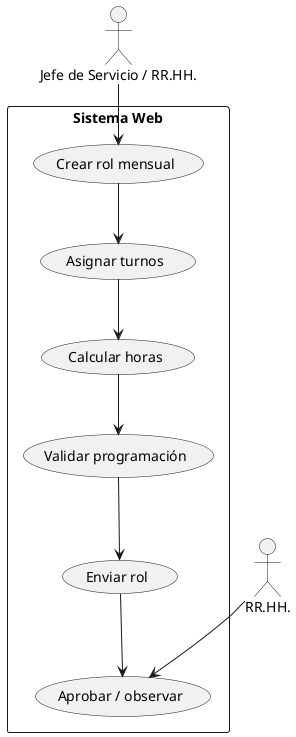
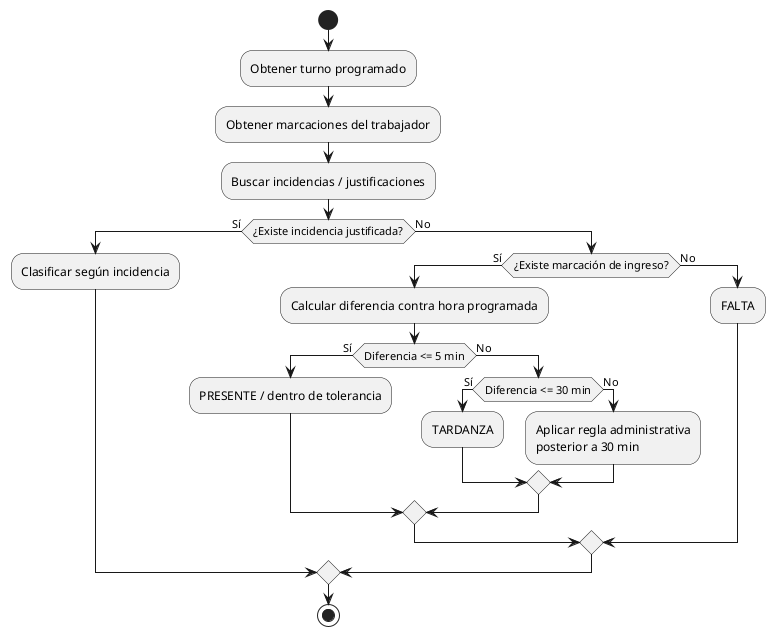
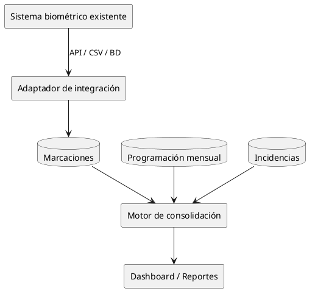
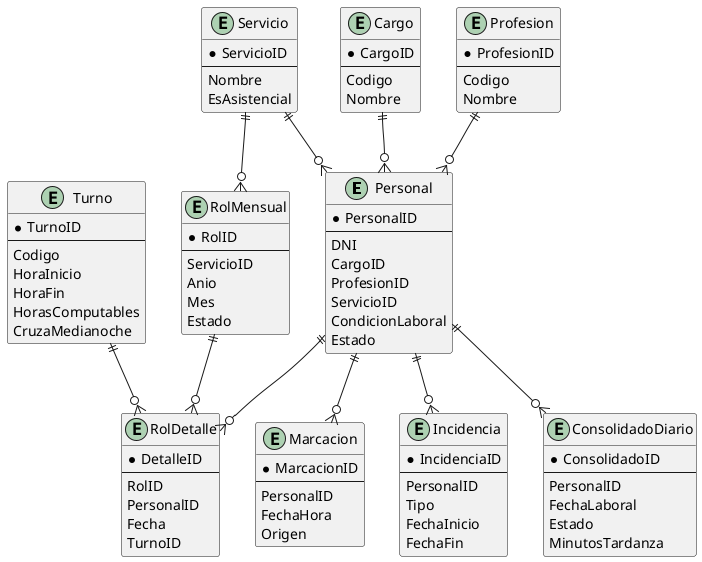

# 13. Diagramas PlantUML

## 13.1 Arquitectura general

```plantuml
@startuml
skinparam componentStyle rectangle

actor "RR.HH." as RRHH
actor "Jefe de Servicio" as Jefe

component "Frontend Web
HTML/CSS/JS" as Front
component "Backend PHP" as Back
database "SQL Server Express" as DB
component "Aplicación biométrica
existente" as Bio

RRHH --> Front
Jefe --> Front
Front --> Back : HTTP / JSON
Back --> DB : SQL
Bio ..> Back : Integración futura
API / archivo / BD

@enduml
```

## 13.2 Flujo de rol mensual



## 13.3 Control de asistencia



## 13.4 Integración de marcaciones



## 13.5 Esquema conceptual de datos


